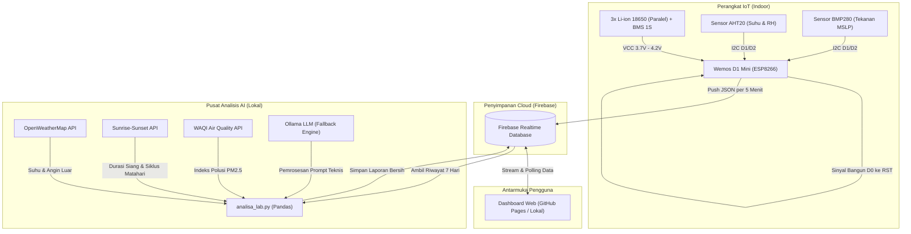

# IoT Monitoring Suhu, Kelembapan & Tekanan Udara

<p align="center">
  <a href="LICENSE"></a>
  <a href="https://www.wemos.cc/"></a>
  <a href="https://firebase.google.com/"></a>
  <a href="https://rangga-ayi.github.io/Monitoring_Suhu/"></a>
  <a href="https://ollama.com/"></a>
</p>

<p align="center">
  Sistem pemantauan iklim mikro ruangan berbasis IoT mandiri dengan mikrokontroler ESP8266 (Wemos D1 Mini), database awan Firebase Realtime Database, dashboard visual tanpa server di GitHub Pages, serta analisis meteorologi dan kesehatan perangkat otomatis menggunakan Ollama AI lokal.
</p>

---

## Ringkasan Proyek

Perangkat ini membaca metrik mikroklimat ruangan meliputi suhu (°C), kelembapan relatif (% RH), dan tekanan udara permukaan laut (MSLP via elevasi lokal), lalu mengirim data ke Firebase Realtime Database setiap 5 menit sekali.

Untuk memperpanjang masa pakai baterai hingga berbulan-bulan, ESP8266 beroperasi dalam siklus **Deep Sleep** (bangun hanya 2–3 detik untuk akuisisi sensor dan transmisi HTTP REST). Data dipantau secara realtime melalui dashboard statis di GitHub Pages dengan visualisasi grafik multi-axis, filter riwayat, ekspor CSV, serta laporan evaluasi berkala yang dihasilkan oleh model bahasa lokal (Ollama AI) terbebas dari halasi silau dan kelelahan membaca.

---

## Tangkapan Layar

### 1. Dashboard Utama (Desktop)


### 2. Modal Analisis AI (Desktop)


### 3. Tampilan Mobile

<p align="center">
  
  &nbsp;&nbsp;&nbsp;&nbsp;
  
</p>

---

## Fitur Utama

### 1. Manajemen Daya Ekstrem & Proteksi Baterai
- **Siklus Deep Sleep 5 Menit:** Mikrokontroler tidur dengan konsumsi arus ~20 µA dan hanya aktif 2–3 detik saat transmisi data.
- **Proteksi Voltase Kritis (Brownout Prevention):** Pin `A0` memonitor tegangan baterai. Jika voltase berada di bawah ambang batas aman (≤ 3.40V), perangkat otomatis tidur panjang selama 1 jam (*hibernation mode*) untuk melindungi sel baterai dari *over-discharge*.
- **Estimasi Kapasitas Non-Linear:** Perhitungan persentase sisa baterai mengacu pada kurva karakteristik pelepasan baterai Li-ion 18650 asli, bukan pembagian tegangan linear sederhana.

### 2. Sensor Presisi & Koreksi Barometrik
- **AHT20 (I2C):** Mengukur temperatur ruangan (°C) dan kelembapan relatif udara (% RH) dengan stabilitas tinggi.
- **BMP280 (I2C):** Mengukur tekanan barometrik absolut dan otomatis dikonversi ke *Mean Sea Level Pressure* (MSLP) dengan formula barometrik berdasar elevasi lokasi.

### 3. Jaringan Tangguh & Komunikasi Langsung
- **WiFi Multi-AP Auto Fallback:** Firmware otomatis beralih ke SSID cadangan apabila jaringan WiFi utama mengalami gangguan koneksi.
- **Transmisi Firebase REST Ringan:** Pengiriman JSON langsung ke Firebase RTDB menggunakan endpoint REST yang dioptimalkan untuk meminimalkan waktu aktif radio WiFi.

### 4. Web Dashboard Tanpa Backend (Serverless)
- **Zero Build Framework:** Berjalan langsung di browser / GitHub Pages menggunakan HTML5 murni, Vanilla JavaScript ES Modules, Bootstrap 5.3, Chart.js, and Gauge.js tanpa memerlukan bundler (Webpack/Vite/Node.js).
- **Sanitasi Data & Penanganan Glitch:** Parser aman (`parseAngka` & `formatAngka`) menolak anomali pembacaan sensor (outlier suhu ≤ 10°C atau -50°C, sentinel ADC 0.00V, dan nilai `null`/`NaN`) tanpa memicu kerusakan visual pada grafik atau tabel.
- **Manajemen Riwayat & Ekspor:** Paginasi data dinamis, penyortiran multi-kolom, filter rentang tanggal, dan unduh rekaman ke file format CSV.

### 5. Analisis AI Terintegrasi & Tipografi Ergonomis (Opsional)

> [!NOTE]
> Modul AI ini bersifat **opsional (nilai tambah / *enhancer*)**. Seluruh fungsi inti sistem monitoring — mulai dari perangkat keras ESP8266, penyimpanan Firebase, hingga visualisasi dashboard web (gauge realtime, grafik tren, tabel data, filter tanggal, dan ekspor CSV) — berfungsi penuh 100% secara mandiri tanpa memerlukan instalasi Ollama maupun eksekusi skrip Python.

- **Korelasi Triangulasi Data:** Memadukan riwayat 7 hari ruangan dengan data meteorologi luar ruangan (OpenWeatherMap), siklus matahari (Sunrise-Sunset API), dan indeks polusi udara (WAQI).
- **Deteksi Pelepasan Panas Malam (*Thermal Lag*):** Menganalisis potensi *heat trap* dan risiko proliferasi jamur ruangan saat ventilasi pasif kurang memadai.
- **Sistem Multi-Model Fallback:** Mencoba daftar model LLM dari yang terakurat hingga model cadangan paling ringan secara otomatis.
- **Ergonomi Membaca & Anti-Halation:** Desain modal AI menerapkan batas lebar baris nyaman (`max-width: 68ch`), kontras warna anti-silau Slate-300 (`#cbd5e1`), penataan ringkasan eksekutif 3 poin di posisi teratas, eliminasi *bold fatigue*, dan pembersihan otomatis notasi matematis LaTeX.

---

## Arsitektur Sistem



---

## Hardware & Skema Rangkaian

### 1. Komponen yang Dibutuhkan

| No  | Komponen | Spesifikasi Rekomendasi | Fungsi Utama |
| :-: | :--- | :--- | :--- |
| 1 | **Mikrokontroler** | Wemos D1 Mini (ESP8266 ESP-12F) | Pemroses data dan pemancar WiFi |
| 2 | **Sensor Suhu & RH** | Modul AHT20 (Antarmuka I2C) | Pembaca temperatur dan kelembapan |
| 3 | **Sensor Barometrik** | Modul BMP280 (Antarmuka I2C) | Pembaca tekanan udara atmosfer |
| 4 | **Catu Daya** | 3x Sel Li-ion 18650 Paralel + BMS 1S | Pasokan daya mandiri (~10.050 mAh) |
| 5 | **Resistor Pembagi Tegangan** | 100 kΩ (Toleransi 1%, 1/4 Watt) | Pembagi tegangan pin pembaca ADC `A0` |
| 6 | **Kabel Jumper** | Jumper Dupont Female-Female | Sambungan antar pin dan sinyal RTC `D0` ➔ `RST` |

### 2. Panduan Sambungan Pin (Pinout)

| Jalur Sistem | Pin Sensor / Modul | Pin Wemos D1 Mini | Keterangan Sambungan |
| :--- | :--- | :--- | :--- |
| **I2C Bus (Bersama)** | `SCL` (AHT20 & BMP280) | `D1 (GPIO 5)` | Jalur Clock I2C |
| | `SDA` (AHT20 & BMP280) | `D2 (GPIO 4)` | Jalur Data I2C |
| | `VCC` (AHT20 & BMP280) | `3V3` | Pasokan tegangan teregulasi 3.3V |
| | `GND` (AHT20 & BMP280) | `G (GND)` | Ground bersama |
| **Deep Sleep Timer** | - | `D0 (GPIO 16)` ➔ `RST` | Penghantar pulsa LOW timer RTC internal ke pin Reset |
| **Pembagi Tegangan Baterai** | Kutub Positif Baterai `(+)` | Seri Resistor 100kΩ ➔ `A0` | Mengonversi skala tegangan 4.2V ke batas aman ADC 3.2V |
| **Masukan Daya Sistem** | Baterai `(+)` via BMS | `5V` / `VCC` | Masuk ke input Low-Dropout Regulator (LDO) internal |
| | Baterai `(-)` via BMS | `G (GND)` | Referensi ground catu daya |

> [!NOTE]
> Pin `A0` Wemos D1 Mini secara internal sudah memiliki rangkaian pembagi tegangan 220kΩ : 100kΩ (maksimum 3.2V). Pemasangan resistor tambahan 100kΩ secara seri di luar pin `A0` menggeser rentang ukur hingga ~4.3V, sehingga ideal untuk membaca tegangan sel lithium saat kondisi penuh (4.2V).

> [!CAUTION]
> **Lepas baterai sebelum menghubungkan kabel USB Wemos ke komputer.** Pin `5V` pada papan Wemos terhubung langsung ke rel USB 5V tanpa dioda proteksi Schottky pemisah. Menghubungkan baterai dan USB secara bersamaan berisiko menimbulkan aliran arus balik yang merusak baterai atau port USB host.

---

## Prasyarat & Zero-Cost Checklist

Semua komponen eksternal yang dipakai dalam repositori ini dapat digunakan secara gratis tanpa kartu kredit:

1. **Hardware:** Wemos D1 Mini, sensor AHT20, BMP280, resistor 100kΩ, sel baterai 18650, kabel micro-USB untuk proses flashing.
2. **Software Development Kit:**
   - [Arduino IDE 2.x](https://www.arduino.cc/en/software)
   - [Python 3.10+](https://www.python.org/downloads/) (didukung di Linux, macOS, dan Windows)
   - Peramban web modern (Google Chrome, Brave, Firefox, atau Edge)
   - [Ollama CLI](https://ollama.com/download) (khusus jika ingin menjalankan AI secara mandiri)
3. **Layanan Cloud & API Gratis:**
   - **Firebase Spark Plan:** Kuota gratis Realtime Database (1 GB penyimpanan, transfer 10 GB/bulan).
   - **OpenWeatherMap API:** Paket *Current Weather* gratis hingga 1.000 panggilan/hari (skrip IoT hanya membutuhkan 1–2 panggilan/hari).
   - **WAQI API:** Token pengembang gratis tanpa batas waktu untuk data stasiun kualitas udara dunia.
   - **Sunrise-Sunset API:** 100% gratis publik, tanpa registrasi, dan tanpa API Key.

---

## Panduan Setup & Menjalankan (Zero Setup Walkthrough)

Ikuti tahapan berurutan berikut untuk menjalankan keseluruhan ekosistem proyek secara mandiri dari awal.

### Tahap 1: Setup Firebase Realtime Database

1. Buka [Firebase Console](https://console.firebase.google.com/) dan buat proyek baru (nonaktifkan Google Analytics jika tidak diperlukan).
2. Di menu navigasi samping, klik **Build > Realtime Database**, lalu klik **Create Database**.
3. Pilih lokasi server terdekat (disarankan `Singapore (asia-southeast1)`). Pilih mode *Start in locked mode*.
4. Salin URL database yang terbentuk (format: `https://<nama-proyek>-asia-southeast1.firebasedatabase.app/`).
5. Buka tab **Rules** pada Realtime Database, tempel aturan keamanan berikut, lalu klik **Publish**:

```json
{
  "rules": {
    "RIWAYAT_LAB": {
      ".read": true,
      ".write": "auth != null",
      ".indexOn": ["timestamp"]
    },
    "LAPORAN_AI": {
      ".read": true,
      ".write": "auth != null"
    }
  }
}
```

6. Dapatkan kredensial untuk masing-masing bagian:
   - **Untuk Firmware ESP8266:** Buka ikon gerigi (*Project Settings*) > **Service Accounts** > **Database Secrets** > salin secret token database Anda.
   - **Untuk Dashboard Web:** Pada halaman ringkasan proyek, daftarkan aplikasi web (**Web </>**), lalu salin blok objek `firebaseConfig`.
   - **Untuk Skrip Python AI:** Buka **Project Settings** > **Service Accounts** > klik tombol **Generate new private key** untuk mengunduh berkas kredensial JSON. Simpan berkas ini di direktori akar repositori.

---

### Tahap 2: Flashing Firmware ESP8266

1. Buka Arduino IDE.
2. Tambahkan URL Board ESP8266: Buka **File > Preferences**, pada kolom *Additional Boards Manager URLs* masukkan:
   ```text
   http://arduino.esp8266.com/stable/package_esp8266com_index.json
   ```
3. Buka **Tools > Board > Boards Manager**, cari `esp8266`, lalu pasang versi terbaru **ESP8266 by ESP8266 Community**.
4. Pasang library yang dibutuhkan via **Tools > Manage Libraries**:
   - `Adafruit AHTX0` (oleh Adafruit)
   - `Adafruit BMP280 Library` (oleh Adafruit)
   - `Firebase ESP Client` (oleh Mobizt)
5. Buka berkas [Wemos_BMP280_ATH20_Firebase/Wemos_BMP280_ATH20_Firebase.ino](file:///d:/PROYEK/Monitoring_Suhu/Wemos_BMP280_ATH20_Firebase/Wemos_BMP280_ATH20_Firebase.ino).
6. Salin berkas template kredensial:
   ```bash
   cp Wemos_BMP280_ATH20_Firebase/secrets_contoh.h Wemos_BMP280_ATH20_Firebase/secrets.h
   ```
7. Buka `Wemos_BMP280_ATH20_Firebase/secrets.h` dan isi parameter Anda:
   ```cpp
   #define FIREBASE_HOST "https://<nama-proyek>-asia-southeast1.firebasedatabase.app/"
   #define FIREBASE_AUTH "DATABASE_SECRET_TOKEN_ANDA"

   #define WIFI_SSID_1 "Nama_WiFi_Utama"
   #define WIFI_PASS_1 "Password_WiFi_Utama"
   #define WIFI_SSID_2 "Nama_WiFi_Cadangan"
   #define WIFI_PASS_2 "Password_WiFi_Cadangan"
   ```
8. **PENTING SAAT FLASHING:**
   - **Lepaskan jumper dari pin `D0` ke `RST`.** (Jika jumper masih terpasang, ESP8266 tidak dapat memasuki mode bootloader flashing).
   - Pastikan baterai dilepas dari Wemos. Hubungkan Wemos ke komputer dengan kabel data micro-USB.
   - Pada Arduino IDE, pilih board **LOLIN(WEMOS) D1 R2 & mini** dan pilih port COM yang sesuai.
   - Klik tombol **Upload**.
9. Setelah proses upload berhasil:
   - Cabut kabel USB.
   - **Pasang kembali jumper kabel dari pin `D0` ke pin `RST`** agar fungsi auto wake-up deep sleep dapat bekerja.
   - Sambungkan konektor baterai. Perangkat akan mulai membaca sensor dan mengirim data setiap 5 menit.

---

### Tahap 3: Menjalankan Dashboard Web

Dashboard dibangun murni berbasis client-side browser tanpa dependensi Node/npm.

#### Opsi A: Jalankan di Komputer Lokal (Instan)

Karena peramban modern membatasi fitur ES Modules pada protokol `file://`, jalankan server lokal bawaan Python dari folder proyek:

```bash
# Jalankan web server ringan di port 8000
python -m http.server 8000
```

Buka peramban di alamat: `http://localhost:8000`

#### Opsi B: Publikasi ke GitHub Pages (Akses Publik Gratis)

1. Buka berkas [index.html](file:///d:/PROYEK/Monitoring_Suhu/index.html), cari deklarasi variabel `firebaseConfig`, lalu ganti dengan konfigurasi proyek Firebase Anda:
   ```javascript
   const firebaseConfig = {
     apiKey: "AIzaSy...",
     authDomain: "proyek-anda.firebaseapp.com",
     databaseURL: "https://proyek-anda-asia-southeast1.firebasedatabase.app",
     projectId: "proyek-anda",
     storageBucket: "proyek-anda.appspot.com",
     messagingSenderId: "...",
     appId: "...",
   };
   ```
2. Lakukan git push ke repositori GitHub Anda.
3. Di halaman repositori GitHub, buka **Settings > Pages**.
4. Pada bagian *Branch*, pilih `main` dan folder `/ (root)`, lalu simpan.
5. Dashboard Anda aktif di URL: `https://<username>.github.io/<nama-repo>/`.

---

### Tahap 4: Setup & Eksekusi Analisis AI via Ollama (Opsional)

> [!TIP]
> **Langkah ini sepenuhnya opsional.** Jika Anda hanya membutuhkan sistem monitoring realtime via web dashboard dan penyimpanan data riwayat, Anda dapat melewati tahap ini. Apabila skrip AI belum pernah dijalankan, tombol *AI Insight* pada dashboard web hanya akan menampilkan status ramah tanpa mengganggu operasional sistem.

Modul ini memproses riwayat telemetri secara lokal tanpa mengirim data pribadi ke penyedia cloud berbayar.

1. **Instalasi Ollama & Pengunduhan Model:**
   - Unduh dan pasang Ollama dari [ollama.com](https://ollama.com/).
   - Buka terminal, unduh model bahasa standar yang diinginkan (pilih sesuai kapasitas RAM komputer Anda):
     ```bash
     # Rekomendasi seimbang (RAM 8 GB - 16 GB):
     ollama pull llama3:8b

     # Alternatif sangat ringan (RAM 4 GB - 8 GB):
     ollama pull llama3.2:3b
     # atau
     ollama pull gemma2:2b
     ```
2. **Pasang Dependensi Python:**
   ```bash
   pip install firebase-admin pandas requests ollama
   ```
3. **Siapkan Berkas Konfigurasi:**
   - Salin template berkas analitik:
     ```bash
     cp analisa_lab_contoh.py analisa_lab.py
     ```
   - Buka [analisa_lab.py](file:///d:/PROYEK/Monitoring_Suhu/analisa_lab.py) dan sesuaikan nilainya:
     ```python
     FIREBASE_KEY_PATH = "berkas-service-account-firebase-anda.json"
     FIREBASE_DB_URL = "https://<nama-proyek>-asia-southeast1.firebasedatabase.app/"

     OWM_API_KEY = "API_KEY_OPENWEATHERMAP_ANDA"
     WAQI_API_KEY = "TOKEN_WAQI_ANDA"  # Biarkan default jika tidak menggunakan WAQI

     LAT_LAB = -2.9761                 # Koordinat Latitude lokasi ruangan
     LON_LAB = 104.7578                # Koordinat Longitude lokasi ruangan
     KOTA_LAB = "Palembang"

     # Model AI prioritas (akan mencoba berurutan jika gagal)
     DAFTAR_MODEL_AI = [
         "llama3:8b",
         "llama3.2:3b",
         "gemma2:2b"
     ]
     ```
4. **Jalankan Skrip:**
   ```bash
   python analisa_lab.py
   ```
   *Skrip akan memvalidasi data 7 hari terakhir, membersihkan outlier sensor, menarik data cuaca luar, menyusun analisis objektif via Ollama, menyimpan berkas teks lokal, dan mengunggah hasil laporan ke node `/LAPORAN_AI` di Firebase.*
5. **Otomatisasi Penjadwalan (Opsional):**
   - **Windows:** Buka *Task Scheduler*, buat tugas berkala yang menjalankan perintah `python C:\jalur\proyek\analisa_lab.py` setiap pukul 06:00 dan 18:00 WIB.
   - **Linux / macOS:** Tambahkan baris cron via `crontab -e`:
     ```text
     0 6,18 * * * /usr/bin/python3 /path/to/Monitoring_Suhu/analisa_lab.py
     ```

---

### Tahap 5: Pemeliharaan Database (Backup & Arsip)

Untuk mencegah kuota penyimpanan gratis Firebase melampaui batas, lakukan pembersihan berkala:

1. Salin template konfigurasi pemeliharaan:
   ```bash
   cp maintenance_db_contoh.py maintenance_db.py
   ```
2. Buka `maintenance_db.py`, sesuaikan nama berkas service account JSON dan URL database.
3. Jalankan pemeliharaan interaktif:
   ```bash
   python maintenance_db.py
   ```
   *Skrip otomatis mengunduh seluruh isi database menjadi file arsip JSON lokal bertanggal (`Backup_Firebase_YYYY-MM-DD_HH-MM-SS.json`) sebelum meminta konfirmasi Anda untuk menghapus rekaman lama di atas rentang hari tertentu.*

---

## Struktur Repositori

```text
├── Assets/                              # Gambar antarmuka dashboard untuk dokumentasi
│   ├── desktop_home.avif
│   ├── desktop_modal_ai.avif
│   ├── mobile_home.avif
│   └── mobile_modal_ai.avif
├── Wemos_BMP280_ATH20_Firebase/
│   ├── Wemos_BMP280_ATH20_Firebase.ino  # Firmware Arduino C++ Wemos D1 Mini
│   ├── secrets_contoh.h                 # Template konfigurasi WiFi & Firebase ESP8266
│   └── secrets.h                        # Kredensial aktif lokal (ter-gitignore)
├── index.html                           # Antarmuka dashboard web statis (Bootstrap 5.3 & Chart.js)
├── analisa_lab_contoh.py                # Template modul analisis AI lingkungan & Ollama
├── analisa_lab.py                       # Skrip analitik aktif dengan kredensial (ter-gitignore)
├── maintenance_db_contoh.py             # Template skrip backup & pembersihan Realtime Database
├── maintenance_db.py                    # Skrip pemeliharaan aktif lokal (ter-gitignore)
├── firebase_adminsdk_contoh.json        # Panduan format berkas service account private key
├── CONTEXT.md                           # Dokumentasi teknis arsitektur & rekam jejak keputusan
├── LICENSE                              # Lisensi resmi proyek (MIT License)
└── README.md                            # Panduan utama sistem
```

---

## Panduan Solusi Kendala (Troubleshooting FAQ)

| Gejala Masalah | Kemungkinan Penyebab Utama | Solusi Penanganan |
| :--- | :--- | :--- |
| **Gagal upload program Arduino (`timed out / espcomm_upload_mem failed`)** | Kabel jumper `D0` ➔ `RST` masih terpasang saat USB dihubungkan. | Lepas kabel jumper `D0` ke `RST`. Pasang kembali hanya setelah proses upload 100% selesai. |
| **Wemos tidak mau bangun dari Deep Sleep setelah 5 menit** | Pin `D0` (GPIO 16) belum terhubung ke pin `RST`. | Pasang jumper dari `D0` ke `RST`. Timer deep sleep internal membutuhkan jalur ini untuk menarik logika reset ke LOW saat timer habis. |
| **Sensor tidak terdeteksi (`AHT20/BMP280 tidak ditemukan`)** | Sambungan bus I2C longgar atau alamat I2C bentrok. | Periksa kabel jumper SDA (`D2`) dan SCL (`D1`). Pastikan modul BMP280 menggunakan alamat `0x76` atau `0x77` (sesuaikan pada baris `bmp.begin(0x76)`). |
| **Tegangan baterai terbaca `0.00 V` di dashboard web** | Resistor pembagi tegangan 100kΩ belum terhubung ke pin `A0`. | Hubungkan kutub positif baterai melalui resistor 100kΩ seri ke pin `A0` Wemos. |
| **Dashboard web menampilkan status "--" atau data kosong** | Aturan keamanan Firebase belum mengizinkan izin baca publik. | Buka tab *Rules* di Firebase RTDB dan pastikan opsi `".read": true` aktif untuk path `RIWAYAT_LAB` dan `LAPORAN_AI`. |
| **Skrip Python gagal menghubungi Ollama (`Connection refused`)** | Aplikasi Ollama belum aktif di komputer host. | Pastikan aplikasi Ollama berjalan di latar belakang (layanan aktif di `http://127.0.0.1:11434`). |

---

## Lisensi

Proyek ini dirilis secara terbuka di bawah lisensi resmi [MIT License](LICENSE). Anda bebas memodifikasi, mendistribusikan, dan menerapkan sistem ini untuk kebutuhan pribadi maupun komersial.

---

## Pembuat & Kontak

**Rangga Ayi Pratama**

- GitHub: [@rangga-ayi](https://github.com/rangga-ayi)
- Email: [pratama.ranggaayi@gmail.com](mailto:pratama.ranggaayi@gmail.com)
- Web Dashboard Live: [rangga-ayi.github.io/Monitoring_Suhu](https://rangga-ayi.github.io/Monitoring_Suhu/)
