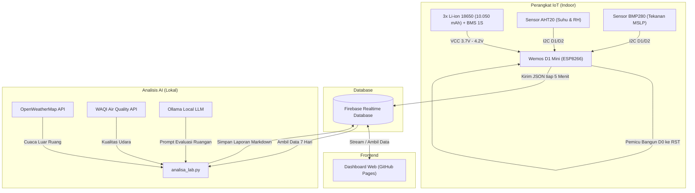

# IoT Monitoring Suhu, Kelembapan & Tekanan Udara

<p align="center">
  <a href="LICENSE"></a>
  <a href="https://www.wemos.cc/"></a>
  <a href="https://firebase.google.com/"></a>
  <a href="https://rangga-ayi.github.io/Monitoring_Suhu/"></a>
  <a href="https://ollama.com/"></a>
</p>

<p align="center">
  Monitoring suhu, kelembapan, dan tekanan udara ruangan berbasis ESP8266. Terkoneksi langsung ke Firebase, punya dashboard web statis di GitHub Pages, dan dilengkapi analisis kondisi lingkungan otomatis menggunakan Ollama AI.
</p>

---

## Ringkasan Proyek

Alat ini membaca suhu ruangan, kelembapan relatif, dan tekanan udara (MSLP), lalu mengirim datanya ke Firebase Realtime Database tiap 5 menit sekali.

Biar baterai awet, ESP8266 diset ke mode deep sleep dan cuma bangun 2-3 detik saat baca sensor dan kirim data. Datanya bisa dipantau langsung lewat web dashboard di GitHub Pages, lengkap dengan grafik riwayat, filter tanggal, ekspor CSV, dan rangkuman harian dari Ollama AI.

---

## Tangkapan Layar

### 1. Dashboard Utama (Desktop)


### 2. Modal Analisis AI (Desktop)


### 3. Tampilan Mobile

<p align="center">
  
  &nbsp;&nbsp;&nbsp;&nbsp;
  
</p>

---

## Fitur Utama

### 1. Hemat Daya & Proteksi Baterai

- **Mode deep sleep:** ESP8266 tidur selama 5 menit dan cuma aktif 2-3 detik buat baca sensor plus upload data.
- **Proteksi voltase rendah:** Pin `A0` memantau sisa tegangan baterai. Kalau turun di bawah 3.4V, alat otomatis masuk mode hibernasi (tidur 1 jam) biar baterai tidak drop.
- **Persentase baterai akurat:** Dihitung menggunakan kurva pengosongan baterai Li-ion 18650 asli, bukan pembagian linear biasa.

### 2. Sensor Lingkungan

- **AHT20:** Mengukur suhu (°C) dan kelembapan udara (% RH) via I2C.
- **BMP280:** Mengukur tekanan udara absolut dan otomatis dikonversi ke tekanan permukaan laut (MSLP) berdasarkan elevasi lokasi.

### 3. Jaringan & Koneksi

- **Auto-fallback WiFi:** Otomatis beralih ke SSID cadangan kalau WiFi utama gagal terhubung.
- **Firebase REST:** Data dikirim langsung ke endpoint Firebase Realtime Database tanpa perlu perantara server.

### 4. Dashboard Web Statis

- **Tanpa backend:** Berjalan langsung di GitHub Pages memakai HTML5, Vanilla JS, Bootstrap 5.3, dan Chart.js.
- **Visualisasi live:** Ada 3 gauge realtime, grafik riwayat multi-axis, dan status koneksi perangkat.
- **Tabel & ekspor:** Dilengkapi paginasi, sortir kolom, filter tanggal, dan tombol unduh CSV.

### 5. Analisis AI Lokal (Opsional)

- **Evaluasi berkala:** Skrip Python otomatis menarik riwayat data 7 hari terakhir, memadukannya dengan data cuaca luar (OpenWeatherMap & WAQI), lalu meminta Ollama lokal membuat rangkuman kenyamanan ruangan.

---

## Arsitektur Sistem



---

## Hardware & Skema Rangkaian

### Daftar Komponen

| No  | Komponen         | Spesifikasi                             | Fungsi                             |
| :-: | :--------------- | :-------------------------------------- | :--------------------------------- |
|  1  | Mikrokontroler   | Wemos D1 Mini (ESP8266)                 | Pemrosesan data dan transmisi WiFi |
|  2  | Sensor Suhu & RH | AHT20 (I2C)                             | Baca suhu dan kelembapan           |
|  3  | Sensor Tekanan   | BMP280 (I2C)                            | Baca tekanan udara                 |
|  4  | Baterai          | 3x 18650 paralel (~10.050 mAh) + BMS 1S | Catu daya mandiri                  |
|  5  | Resistor         | 100 kΩ (1/4W, 1%)                       | Pembagi tegangan pin `A0`          |
|  6  | Jumper           | Kabel jumper `D0` ke `RST`              | Jalur trigger bangun deep sleep    |

### Pinout

| Jalur                        | Pin Komponen          | Pin Wemos D1 Mini          | Keterangan                    |
| :--------------------------- | :-------------------- | :------------------------- | :---------------------------- |
| **I2C Bus (AHT20 & BMP280)** | `SCL`                 | `D1 (GPIO 5)`              | Clock I2C                     |
|                              | `SDA`                 | `D2 (GPIO 4)`              | Data I2C                      |
|                              | `VCC`                 | `3V3`                      | Catu daya sensor 3.3V         |
|                              | `GND`                 | `G` (GND)                  | Ground bersama                |
| **Deep Sleep Wake-up**       | -                     | `D0 (GPIO 16)` ➔ `RST`     | Sinyal bangun dari timer RTC  |
| **Monitoring Baterai**       | Baterai `(+)`         | Resistor 100kΩ seri ➔ `A0` | Perluas rentang ukur ADC 4.3V |
| **Input Daya**               | Baterai `(+)` via BMS | `5V` / `VCC`               | Menuju regulator internal     |
|                              | Baterai `(-)` via BMS | `G` (GND)                  | Ground sistem                 |

> [!NOTE]
> Pin `A0` bawaan ESP8266 cuma bisa membaca voltase maksimal 3.2V. Pemasangan resistor 100kΩ secara seri memperluas batas ukur sampai 4.3V, jadi aman membaca voltase baterai Li-ion saat terisi penuh (4.2V).

> [!CAUTION]
> Cabut baterai sebelum menghubungkan kabel USB ke laptop atau charger. Pin `5V` pada Wemos terhubung langsung ke jalur USB tanpa dioda pengaman, sehingga berisiko merusak baterai atau port USB akibat arus balik.

---

## Panduan Setup & Instalasi

### 1. Konfigurasi Firebase Realtime Database

1. Buat project baru di [Firebase Console](https://console.firebase.google.com/).
2. Aktifkan **Realtime Database** (pilih lokasi terdekat, misalnya `asia-southeast1`).
3. Catat **Database URL** (`https://<project-id>-asia-southeast1.firebasedatabase.app/`).
4. Siapkan kredensial akses:
   - **Firmware:** Ambil _Database Secret_ di menu _Project Settings > Service Accounts > Database Secrets_.
   - **Dashboard Web:** Daftarkan Web App di Firebase Console untuk mendapatkan konfigurasi `firebaseConfig`.
   - **Script Python:** Unduh file Service Account JSON dari tab _Service Accounts_.

---

### 2. Flashing Firmware ESP8266

1. Buka Arduino IDE.
2. Pasang board package **ESP8266 by ESP8266 Community** lewat _Boards Manager_.
3. Pasang library berikut via _Library Manager_:
   - `Adafruit AHTX0`
   - `Adafruit BMP280 Library`
   - `Firebase ESP Client` (oleh Mobizt)
4. Buka folder `Wemos_BMP280_ATH20_Firebase/`.
5. Salin `secrets_contoh.h` jadi `secrets.h`, lalu isi kredensial Anda:

   ```cpp
   #define FIREBASE_HOST "https://your-project-asia-southeast1.firebasedatabase.app/"
   #define FIREBASE_AUTH "YOUR_DATABASE_SECRET_KEY"

   // Konfigurasi WiFi (WiFi Utama & Cadangan)
   #define WIFI_SSID_1 "NamaWiFiUtama"
   #define WIFI_PASS_1 "PasswordWiFiUtama"
   #define WIFI_SSID_2 "NamaWiFiCadangan"
   #define WIFI_PASS_2 "PasswordWiFiCadangan"
   ```

6. Pilih board **LOLIN(WEMOS) D1 R2 & mini** dan sesuaikan Port COM.
7. Lepas jumper `D0` ke `RST`, colok kabel USB, lalu klik **Upload**.
8. Kalau sudah selesai, cabut USB, pasang kembali jumper `D0` ke `RST`, lalu hubungkan baterai.

---

### 3. Menjalankan Dashboard Web

#### Opsi A: Deployment ke GitHub Pages (Gratis)

1. Push repositori ini ke akun GitHub Anda.
2. Buka `index.html` dan isi objek `firebaseConfig`:
   ```javascript
   const firebaseConfig = {
     apiKey: "AIzaSy...",
     authDomain: "your-project.firebaseapp.com",
     databaseURL: "https://your-project-asia-southeast1.firebasedatabase.app",
     projectId: "your-project",
     storageBucket: "your-project.appspot.com",
     messagingSenderId: "...",
     appId: "...",
   };
   ```
3. Buka menu **Settings > Pages** di repositori GitHub.
4. Pilih branch `main` dan folder `/ (root)`, lalu klik **Save**.
5. Buka link dashboard di `https://<username>.github.io/<repo-name>/`.

#### Opsi B: Jalankan di Server Lokal

Karena dashboard memakai modul ES, jalankan lewat server HTTP lokal:

```bash
python -m http.server 8000
```

Buka `http://localhost:8000` di browser.

---

### 4. Setup Analisis AI (Opsional)

1. Unduh dan pasang Ollama dari [ollama.com](https://ollama.com/), lalu tarik model:
   ```bash
   ollama pull gemma4:cloud
   ```
2. Pasang library Python:
   ```bash
   pip install firebase-admin pandas requests ollama
   ```
3. Siapkan file konfigurasi:
   - Salin template skrip:
     ```bash
     cp analisa_lab_contoh.py analisa_lab.py
     ```
   - Taruh file Service Account JSON Firebase di folder proyek.
   - Buka `analisa_lab.py` lalu isi API Key OpenWeatherMap, Token WAQI, koordinat lokasi, dan URL database.
4. Jalankan skrip pengujian:
   ```bash
   python analisa_lab.py
   ```
5. Jadwalkan otomatis via Windows Task Scheduler agar berjalan berkala (misal tiap 12 jam).

---

### 5. Skrip Pemeliharaan Database (Opsional)

Biar kuota Firebase Free Tier tetap aman:

1. Salin template skrip:
   ```bash
   cp maintenance_db_contoh.py maintenance_db.py
   ```
2. Jalankan pemeliharaan:
   ```bash
   python maintenance_db.py
   ```
   Skrip akan membuat backup data ke file `Backup_Firebase_YYYY-MM-DD.json` sebelum menghapus entri lama sesuai konfirmasi Anda.

---

## Struktur Repositori

```text
├── Assets/                              # Tangkapan layar antarmuka dashboard
│   ├── desktop_home.avif
│   ├── desktop_modal_ai.avif
│   ├── mobile_home.avif
│   └── mobile_modal_ai.avif
├── Wemos_BMP280_ATH20_Firebase/
│   ├── Wemos_BMP280_ATH20_Firebase.ino  # Firmware C++ ESP8266
│   ├── secrets_contoh.h                 # Template konfigurasi WiFi & Firebase
│   └── secrets.h                        # Kredensial aktif (diabaikan git)
├── index.html                           # Dashboard web statis
├── analisa_lab_contoh.py                # Template analitik AI (Ollama)
├── maintenance_db_contoh.py             # Template backup dan pembersihan data
├── firebase_adminsdk_contoh.json        # Template kredensial service account
├── LICENSE                              # Lisensi MIT
└── README.md                            # Dokumentasi utama
```

---

## Aturan Keamanan Firebase

Gunakan konfigurasi Security Rules berikut di Firebase Console agar dashboard bisa membaca data tanpa memberi izin tulis ke publik:

```json
{
  "rules": {
    "RIWAYAT_LAB": {
      ".read": true,
      ".write": "auth != null"
    },
    "LAPORAN_AI": {
      ".read": true,
      ".write": "auth != null"
    }
  }
}
```

---

## Lisensi

Proyek ini menggunakan lisensi [MIT](LICENSE).

---

## Kontak

**Rangga Ayi Pratama**

- GitHub: [@rangga-ayi](https://github.com/rangga-ayi)
- Email: [pratama.ranggaayi@gmail.com](mailto:pratama.ranggaayi@gmail.com)
- Live Dashboard: [rangga-ayi.github.io/Monitoring_Suhu](https://rangga-ayi.github.io/Monitoring_Suhu/)
