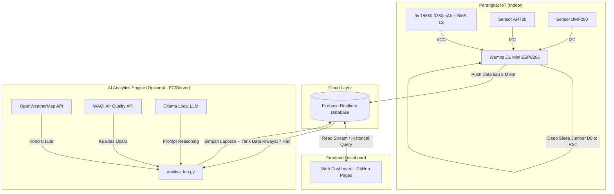

# IoT Monitoring Suhu, Kelembapan & Tekanan Udara

[](LICENSE)
[](https://www.wemos.cc/)
[](https://firebase.google.com/)
[](https://rangga-ayi.github.io/Monitoring_Suhu/)
[](https://ollama.com/)

Sistem pemantauan lingkungan ruangan berbasis IoT hemat daya. Perangkat membaca suhu, kelembapan relatif, dan tekanan udara (MSLP), lalu mengirim data ke Firebase Realtime Database setiap 5 menit. Dashboard web statis di GitHub Pages menampilkan data secara realtime, dilengkapi modul analitik berkala menggunakan Ollama dan data cuaca eksternal.

---

## Daftar Isi
- [Fitur Utama](#fitur-utama)
- [Arsitektur Sistem](#arsitektur-sistem)
- [Hardware & Skema Rangkaian](#hardware--skema-rangkaian)
- [Catatan Keselamatan](#catatan-keselamatan-penting)
- [Panduan Setup & Instalasi](#panduan-setup--instalasi)
  - [1. Konfigurasi Firebase Realtime Database](#1-konfigurasi-firebase-realtime-database)
  - [2. Flashing Firmware (ESP8266 / Wemos D1 Mini)](#2-flashing-firmware-esp8266--wemos-d1-mini)
  - [3. Menjalankan Dashboard Web](#3-menjalankan-dashboard-web)
  - [4. Setup AI Insight Terjadwal (Opsional)](#4-opsional-setup-ai-insight-terjadwal)
  - [5. Skrip Maintenance Database (Opsional)](#5-opsional-skrip-maintenance-database)
- [Struktur Repositori](#struktur-repositori)
- [Keamanan Data & Firebase Rules](#keamanan-data--firebase-rules)
- [Lisensi](#lisensi)
- [Kontak](#kontak)

---

## Fitur Utama

- **Hemat daya (deep sleep):** ESP8266 berada dalam mode deep sleep selama 5 menit dan aktif ~2–3 detik untuk membaca sensor serta mengirim data.
- **Sensor lingkungan:**
  - **AHT20:** mengukur suhu (°C) dan kelembapan relatif (% RH) via I2C.
  - **BMP280:** mengukur tekanan udara absolut dan mengonversinya ke *Mean Sea Level Pressure* (MSLP) berdasarkan elevasi lokasi.
- **Proteksi baterai:** membaca tegangan baterai 18650 melalui pin `A0`. Masuk mode hibernasi (deep sleep 1 jam) jika tegangan turun di bawah 3.4V.
- **Multi-AP WiFi fallback:** beralih otomatis ke SSID cadangan jika koneksi utama gagal.
- **Web dashboard statis:** dibuat dengan HTML5, CSS, Vanilla JS, dan Chart.js (tanpa backend server, siap di-host di GitHub Pages).
  - Monitoring realtime dan visualisasi riwayat dengan paginasi.
  - Indikator status koneksi, persentase baterai, dan rentang kenyamanan (*comfort zone*).
  - Ekspor data riwayat ke format JSON dan CSV.
- **Analisis AI lokal (opsional):** skrip Python untuk mengevaluasi data 7 hari terakhir menggunakan Ollama serta data cuaca outdoor (OpenWeatherMap dan WAQI).

---

## Arsitektur Sistem



---

## Hardware & Skema Rangkaian

### Daftar Komponen
1. Wemos D1 Mini (ESP8266)
2. Sensor AHT20 + BMP280 (modul kombo I2C atau modul terpisah)
3. 3x Baterai Li-ion 18650 (paralel ≈ 10.050 mAh) + BMS 1S
4. Resistor 100kΩ (1/4W) untuk pembagi tegangan pin `A0`
5. Kabel jumper / PCB prototipe

### Tabel Pinout

| Komponen / Jalur | Pin Sensor / Baterai | Pin Wemos D1 Mini | Keterangan |
| :--- | :--- | :--- | :--- |
| I2C Bus (AHT20 & BMP280) | `SCL` | `D1 (GPIO 5)` | Clock I2C |
| | `SDA` | `D2 (GPIO 4)` | Data I2C |
| | `VCC` | `3V3` | Catu daya sensor (3.3V) |
| | `GND` | `G` (GND) | Ground bersama |
| Deep Sleep Wake-up | - | `D0 (GPIO 16)` ➔ `RST` | Jumper untuk trigger wake-up timer |
| Monitoring Baterai | Baterai `(+)` | Melalui resistor 100kΩ ➔ `A0` | Memperluas jangkauan ukur ADC hingga ~4.3V |
| Power Input | Baterai `(+)` via BMS | `5V` / `VCC` | Menuju regulator internal Wemos |
| | Baterai `(-)` via BMS | `G` (GND) | Ground sistem |

> **Catatan Pembagi Tegangan Pin A0:**
> Wemos D1 Mini memiliki pembagi tegangan bawaan (220kΩ : 100kΩ) dengan batas input maksimal 3.2V. Menambahkan resistor 100kΩ secara seri dari kutub positif baterai ke pin `A0` memungkinkan pembacaan tegangan baterai penuh (4.2V) tanpa melebihi batas ADC ESP8266.
>
> **Karakteristik Baterai (Berdasarkan Log Riil):**
> Mengacu pada data 24 jam di `Data_Lab_date.csv` (298 sampel, interval 5 menit):
> - Penurunan tegangan rata-rata 0.15V - 0.20V per hari pada operasi normal.
> - Kapasitas 3x 18650 paralel (≈ 10.050 mAh) dapat beroperasi mandiri berminggu-minggu tergantung kekuatan sinyal WiFi.
> - Dashboard menghitung persentase baterai menggunakan kurva piecewise non-linear agar sesuai kurva pengosongan Li-ion.

---

## Catatan Keselamatan Penting

> [!CAUTION]
> **Lepaskan baterai sebelum menghubungkan kabel USB ke komputer atau charger.**
> Pin `5V` pada Wemos D1 Mini terhubung langsung ke jalur `VBUS` USB tanpa dioda isolasi. Menghubungkan USB saat baterai terpasang dapat mengalirkan arus balik 5V langsung ke baterai Li-ion dan berisiko merusak port USB atau baterai.

---

## Panduan Setup & Instalasi

### 1. Konfigurasi Firebase Realtime Database
1. Buat project di [Firebase Console](https://console.firebase.google.com/).
2. Aktifkan **Realtime Database** (pilih lokasi terdekat, misal `asia-southeast1`).
3. Catat **Database URL** (`https://<project-id>-asia-southeast1.firebasedatabase.app/`).
4. Siapkan kredensial:
   - **Firmware:** ambil *Database Secret* (Legacy Token) di *Project Settings > Service Accounts > Database Secrets*.
   - **Web Dashboard:** daftarkan Web App di Firebase Console untuk mendapatkan `firebaseConfig` (`apiKey`, `projectId`, `appId`).
   - **Script Python:** unduh Service Account JSON Private Key dari menu *Service Accounts*.

---

### 2. Flashing Firmware (ESP8266 / Wemos D1 Mini)
1. Buka **Arduino IDE**.
2. Pasang board package **ESP8266 by ESP8266 Community** via *Boards Manager*.
3. Pasang library berikut via *Library Manager*:
   - `Adafruit AHTX0`
   - `Adafruit BMP280 Library`
   - `Firebase ESP Client` (oleh Mobizt)
4. Buka direktori `Wemos_BMP280_ATH20_Firebase/`.
5. Salin `secrets_contoh.h` menjadi `secrets.h` dan isi kredensial:
   ```cpp
   #define FIREBASE_HOST "https://your-db-id-asia-southeast1.firebasedatabase.app/"
   #define FIREBASE_AUTH "YOUR_DATABASE_SECRET_OR_LEGACY_TOKEN"

   // Konfigurasi WiFi
   #define WIFI_SSID_1 "NamaWiFiUtama"
   #define WIFI_PASS_1 "PasswordWiFiUtama"
   #define WIFI_SSID_2 "NamaWiFiCadangan"
   #define WIFI_PASS_2 "PasswordWiFiCadangan"
   ```
6. Pilih board **LOLIN(WEMOS) D1 R2 & mini** dan tentukan Port COM.
7. Lepaskan baterai, hubungkan kabel USB, lalu jalankan **Upload**.
8. Setelah selesai, cabut USB, hubungkan jumper `D0` ke `RST`, lalu pasang kembali baterai.

---

### 3. Menjalankan Dashboard Web

#### Opsi A: Deployment ke GitHub Pages
1. Push repositori ini ke GitHub.
2. Buka `index.html` dan sesuaikan variabel `firebaseConfig` pada tag `<script type="module">`:
   ```javascript
   const firebaseConfig = {
     apiKey: "YOUR_API_KEY",
     authDomain: "your-db-id.firebaseapp.com",
     databaseURL: "https://your-db-id-asia-southeast1.firebasedatabase.app",
     projectId: "your-db-id",
     storageBucket: "your-db-id.appspot.com",
     messagingSenderId: "...",
     appId: "..."
   };
   ```
3. Buka **Settings > Pages** pada repositori GitHub.
4. Set branch ke `main` dan folder `/ (root)`, lalu simpan.
5. Akses dashboard di `https://<username>.github.io/<repository-name>/`.

#### Opsi B: Web Server Lokal
Dashboard menggunakan modul ES (`type="module"`), sehingga memerlukan HTTP server lokal:
```bash
python -m http.server 8000
# Buka di browser: http://localhost:8000
```

---

### 4. (Opsional) Setup AI Insight Terjadwal

Skrip ini membaca riwayat 7 hari dari Firebase, mengambil data cuaca luar, lalu meminta LLM lokal (Ollama) menyusun ringkasan kenyamanan ruangan.

1. **Install Ollama** dari [ollama.com](https://ollama.com/) dan unduh model:
   ```bash
   ollama pull gemma4:cloud   # atau: ollama pull llama3:8b / qwen2.5:7b
   ```
2. **Install dependensi Python:**
   ```bash
   pip install firebase-admin pandas requests ollama
   ```
3. **Konfigurasi File:**
   - Salin `analisa_lab_contoh.py` menjadi `analisa_lab.py`:
     ```bash
     cp analisa_lab_contoh.py analisa_lab.py
     ```
   - Letakkan file Service Account JSON di direktori root.
   - Buka `analisa_lab.py` dan lengkapi API key OpenWeatherMap, WAQI token, koordinat lokasi, serta database URL.
4. Jalankan pengujian:
   ```bash
   python analisa_lab.py
   ```
5. **Otomasi Penjadwalan (Windows Task Scheduler):**
   - Buat *Basic Task* baru di Windows Task Scheduler.
   - Trigger: Harian pukul `00:00` dan `12:00` (interval 12 jam).
   - Action: Start a Program -> `python.exe` dengan argumen path lengkap ke `analisa_lab.py`.

---

### 5. (Opsional) Skrip Maintenance Database

Untuk menjaga penggunaan kuota Firebase Free Tier:
1. Salin template script:
   ```bash
   cp maintenance_db_contoh.py maintenance_db.py
   ```
2. Jalankan script:
   ```bash
   python maintenance_db.py
   ```
Skrip akan mencadangkan seluruh data riwayat ke file `Backup_Firebase_YYYY-MM-DD.json` dan memberikan konfirmasi sebelum menghapus data lama di Firebase.

---

## Struktur Repositori

```text
├── Wemos_BMP280_ATH20_Firebase/
│   ├── Wemos_BMP280_ATH20_Firebase.ino  # Firmware ESP8266
│   ├── secrets_contoh.h                 # Template kredensial WiFi & Firebase
│   └── secrets.h                        # Kredensial aktif (diabaikan git)
├── index.html                           # Single-page web dashboard
├── analisa_lab_contoh.py                # Template analitik AI (Ollama + OpenWeather/WAQI)
├── maintenance_db_contoh.py             # Template backup dan pembersihan data Firebase
├── firebase_adminsdk_contoh.json        # Template struktur Firebase Service Account Key
├── CLAUDE.md                            # Panduan teknis arsitektur proyek
├── LICENSE                              # Lisensi proyek (MIT)
└── README.md                            # Dokumentasi utama proyek
```

---

## Keamanan Data & Firebase Rules

Terapkan aturan keamanan berikut di Firebase Console agar dashboard dapat membaca data tanpa memberi izin modifikasi kepada publik:

```json
{
  "rules": {
    "RIWAYAT_LAB": {
      ".read": true,
      ".write": "auth != null"
    },
    "LAPORAN_AI": {
      ".read": true,
      ".write": "auth != null"
    }
  }
}
```

---

## Lisensi

Proyek ini menggunakan lisensi [MIT](LICENSE).

---

## Kontak

**Rangga Ayi Pratama**
- GitHub: [@rangga-ayi](https://github.com/rangga-ayi)
- Email: [pratama.ranggaayi@gmail.com](mailto:pratama.ranggaayi@gmail.com)
- Live Demo: [rangga-ayi.github.io/Monitoring_Suhu](https://rangga-ayi.github.io/Monitoring_Suhu/)
